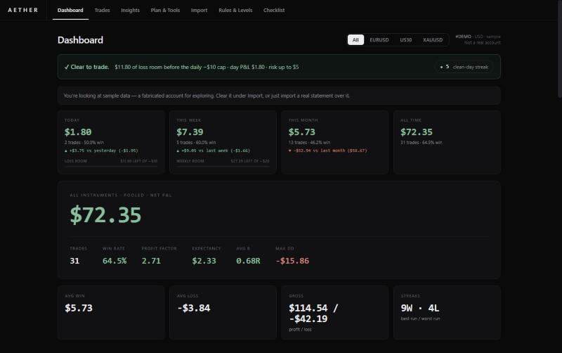

### Hey, I'm adu 👋

I trade and I build. Mostly I make the tools I wanted and couldn't find: single-file web apps that work offline and keep your data on your own device. No accounts, no servers.

**Portfolio:** [adu21-8.github.io](https://adu21-8.github.io)

---

### Featured: [Aether](https://github.com/adu21-8/aether)

An offline trading journal for MetaTrader 5. Import your statement, tag what you did, and hold yourself to the risk rules you actually set.

- Reads MT5 trade history reports directly, including UTF-16 exports
- Rule engine flags every trade that breaks your per-trade, daily or weekly loss caps
- Discipline-adjusted equity curve: your account if you had skipped every rule-breaking trade
- R-multiple distribution, weekday × hour heatmap, drawdowns, daily journal, pre-trade checklist

**[Open the web app →](https://aether-trade.netlify.app/)** &nbsp;·&nbsp; [Source](https://github.com/adu21-8/aether)

---

### Also building

| Project | What it is | |
|---|---|---|
| **Orrery** | A solar system you can play. Planets ring notes as they cross the meridian, with orbit speeds from Kepler's third law. | [Play it](https://adu21-8.github.io/orrery/) |
| **Desktop Widgets** | A click-through widget overlay for Windows on top of Wallpaper Engine: system gauges, weather, media controls, an app launcher. | Private for now |

### Tools I use

`HTML` `CSS` `JavaScript` `Electron` `PowerShell` `Web Audio` `MetaTrader 5`
